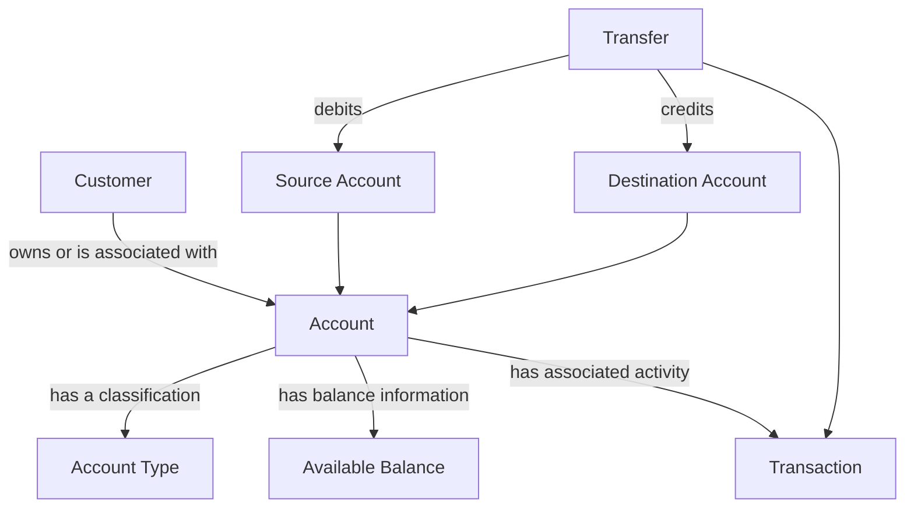

## 1. Domain Map

### 1.1 Product-Specific Information — ParaBank

The following information is based on observations from the ParaBank demo application and its API. Only directly observed information is treated as confirmed product evidence.

| Concept | Observed Product Information | Evidence |
|---|---|---|
| **Customer** | An account is associated with a customer identifier. | API response: `customerId: 12212` |
| **Account** | The API returns an account identifier and account-related information. | API response: `id: 12345` |
| **Account Type** | The account type is returned as `CHECKING`. | API response: `type: CHECKING` |
| | **Available Balance** | The UI displays an "Available Amount" field. Its relationship to the API's `balance` field has not yet been verified. | UI observation; API response: `balance: -2300.00` | 
| **Transaction** | A completed transfer is visible in Account Details transaction history. The record remains visible after a page refresh. | UI observation |
| **Transfer** | Transfers between different accounts can complete and affect both balances. Zero and negative amounts are also accepted with a success message. | UI observation; balance behavior documented in Section 4 |
| **Source Account** | Its role in a transfer is conceptually identified, but the corresponding product behavior has not yet been verified. | Further UI/API exploration required |
| **Destination Account** | Its role in a transfer is conceptually identified, but the corresponding product behavior has not yet been verified. | Further UI/API exploration required |

**Observed API evidence**

`GET /parabank/services/bank/accounts/12345`

HTTP status: `200 OK`

```json
{
  "id": 12345,
  "customerId": 12212,
  "type": "CHECKING",
  "balance": -2300.00
}
```

The response confirms the presence of the listed fields. It does not, by itself, establish all account business rules or transfer behavior.

### 1.2 General Banking Concepts

The following definitions describe general banking concepts. They must not be interpreted as confirmation that ParaBank implements every related behavior.

| Concept | Definition |
|---|---|
| **Customer** | A person who uses banking services and may own one or more bank accounts. |
| **Account** | A financial record used to track a customer's funds and account activity. |
| **Account Type** | A classification that identifies the kind of account, such as checking or savings. |
| **Available Balance** | The amount a customer can currently use or withdraw, subject to account restrictions and pending transactions. It may differ from the current account balance. |
| **Transaction** | A record of a financial event affecting an account, such as a deposit, withdrawal or transfer. |
| **Transfer** | An operation that moves money from a source account to a destination account. |
| **Source Account** | The account from which the transfer amount is debited. |
| **Destination Account** | The account to which the transfer amount is credited. |

### 1.3 Conceptual Relationships

The following diagram represents the general banking domain model, not a fully verified implementation of ParaBank.



**Relationship summary**

- A customer may own one or more accounts.
- An account has a type and balance information.
- Transactions represent financial activities associated with accounts.
- A transfer involves a source account and a destination account.
- A transfer may be represented by one or more transaction records, depending on the banking system.

**Evidence distinction:** The account fields shown in Section 1.1 were observed in ParaBank. The remaining definitions and conceptual relationships in Sections 1.2 and 1.3 describe general banking knowledge unless separately confirmed through product evidence.

## 2. User Journeys and Acceptance Criteria

### UJ-01 — Login and View Accounts

**Goal:** Verify that an account holder can log in and view their accounts.

**Preconditions**
- The customer has a registered ParaBank account.
- Valid login credentials are available.

**User journey**
1. The customer opens the ParaBank application.
2. The customer enters a username and password.
3. The customer submits the login form.
4. The application processes the login request.
5. The customer opens the accounts section.
6. The customer selects an account to view its details.

**Acceptance criteria**

- **AC-01:** Given valid credentials, when the customer submits the login form, then the application grants access to the authenticated area.
- **AC-02:** After successful login, the customer can access the accounts section and view the accounts associated with their customer profile.
- **AC-03:** When the customer selects an account, the application displays the details associated with that account.


---

### UJ-02 — Transfer Money Between Two Accounts

**Goal:** Verify that a customer can transfer money from a source account to a destination account.

**Preconditions**
- The customer is logged in.
- Two eligible accounts are available.
- The transfer amount satisfies the applicable business rules.

**User journey**
1. The customer opens the transfer section.
2. The customer selects a source account.
3. The customer selects a destination account.
4. The customer enters the transfer amount.
5. The customer submits the transfer.
6. The application processes the request and displays the result.

**Acceptance criteria**

- **AC-04:** Given valid transfer details, when the customer submits the transfer, then the application displays the outcome of the operation.
- **AC-05:** If the transfer succeeds, the source account's balance decreases and the destination account's balance increases by the expected amounts, subject to applicable fees and business rules.
- **AC-06:** If the transfer details are invalid, the application handles the request according to the defined validation rules and does not incorrectly report success.


---

### UJ-03 — Verify the Transfer in Transaction History

**Goal:** Verify that a completed transfer can be traced through the account's transaction history.

**Preconditions**
- A transfer has been submitted successfully.
- The relevant account and transaction history are accessible.

**User journey**
1. The customer opens the relevant account details.
2. The customer navigates to transaction history or account activity.
3. The customer locates the transfer.
4. The customer checks the transaction amount and any available transaction details.
5. If records are available for both accounts, the customer checks the corresponding activity.
6. The customer compares the displayed information with the transfer result and available API data.

**Acceptance criteria**

- **AC-07:** If the application exposes transfer history, the completed transfer can be located in the relevant account activity.
- **AC-08:** The displayed transaction amount matches the amount submitted for the successful transfer.
- **AC-09:** If activity records are available for both accounts, the recorded changes are consistent with the expected debit and credit.
- **AC-10:** Where equivalent information is available from the UI and API, the values are consistent.


---

### Journey Validation Notes

- Acceptance criteria describe expected behavior and must be verified against the actual application.
- The existence of an API `balance` field does not establish that it is equivalent to the UI's **Available Amount** field.
- Transaction-history availability, transfer fees, balance-update timing and detailed validation rules must be confirmed through product exploration or clarification.

## 4. Business Rule Validation

The following results are based on exploratory testing of the ParaBank demo application. Observed behavior is documented separately from expected business rules that require confirmation.

| ID | Test Input / Scenario | Observed Result | Status |
|---|---|---|---|
| BR-01a | Zero transfer amount | A success message is displayed, but no balance change is visible. | Observed |
| BR-01b | Negative transfer amount | A success message is displayed. The source balance increases, while the destination balance decreases. | Observed |
| BR-01c | Very high transfer amount | A success message is displayed. The resulting balance changes have not yet been confirmed. | Partially verified |
| BR-02 | Same source and destination account | A "Transfer Complete" message is displayed, but no balance change is visible in Account Overview. | Observed |
| BR-03 | Repeated transfer with the same accounts and amount | Both transfer attempts display "Transfer Complete", and balance changes occur after each attempt. | Observed |
| BR-04 | Transfer amount exceeds source balance | The transfer is completed. The destination balance increases, while the source balance becomes negative. | Observed |
| BR-05 | Transfer transaction history | The transfer is visible in Account Details after completion. | Observed |
| BR-06 | Account visibility and transfer access | The logged-in user can view their own accounts and initiate transfers between them. Access to another customer's account has not been tested directly. | Partially verified |
| BR-07 | Transfer result and balance consistency | For a normal positive transfer, the observed source and destination balance changes are consistent with the transfer amount. | Observed |
| BR-08 | Transaction history after page refresh | The transfer record remains visible in Account Details after the page is refreshed. | Observed |

### QA Notes

- **BR-01:** The expected behavior for zero, negative, and unusually high transfer amounts requires confirmation against product requirements.
- **BR-02:** Whether same-account transfers should be rejected remains an open business rule.
- **BR-03:** Repeating a transfer manually does not establish whether the system supports idempotency for repeated technical requests.
- **BR-04:** The application permits a transfer that exceeds the source balance. Whether overdrafts are permitted must be confirmed.
- **BR-05 and BR-08:** The transfer record is visible and persists across a page refresh. The correctness of all transaction details has not yet been verified.
- **BR-06:** Access restrictions for other customers' accounts and transaction histories require direct authorization testing.
- **BR-07:** The observed balance changes for a normal positive transfer are consistent with the transfer amount. This does not establish that all transfer validation rules are correct.

### Validation Limitations

These results describe observed application behavior and do not independently establish the intended business rules. Potential defects should be confirmed against requirements before being classified as confirmed defects.
